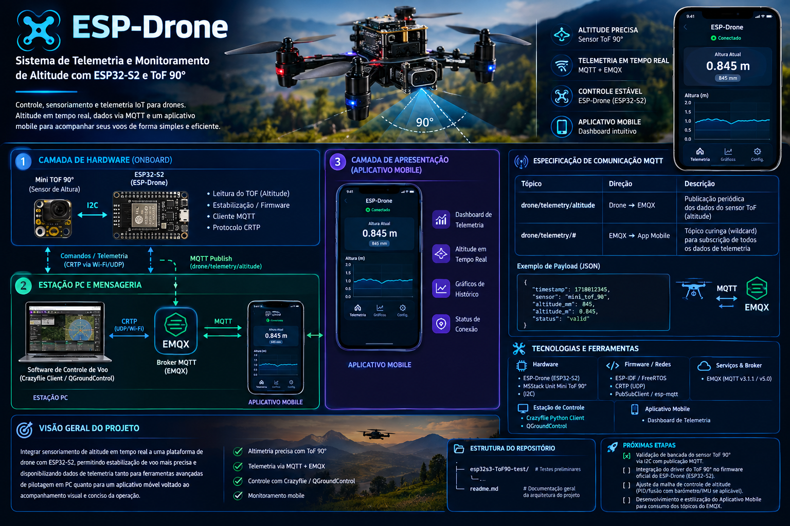

# ESP-Drone: Sistema de Telemetria, Sensoriamento ToF 90°, OTA Centralizado e Motor de IA de Frota

Sistema integrado de controle, sensoriamento e telemetria IoT para veículos aéreos não tripulados (drones). O projeto utiliza microcontroladores **ESP32-S3 / ESP32-S2** integrados ao sensor de distância óptico **Unit Mini ToF 90°** para medição precisa de altitude, broker **EMQX Enterprise** em nuvem (AWS EC2) para distribuição de dados em tempo real, um **Servidor Central Node.js** com motor de **Machine Learning Real (Isolation Forest & K-Means)** e orquestração **Over-The-Air (OTA)** para toda a frota, além de um **aplicativo mobile** dedicado com **Edge AI Copilot**.

---

## 📌 Visão Geral do Projeto

O objetivo principal deste projeto é integrar sensoriamento de altitude em tempo real a uma plataforma de drone com ESP32, permitindo estabilização de voo mais precisa e disponibilizando dados de telemetria tanto para ferramentas avançadas de pilotagem em PC quanto para um dashboard web administrativo e um aplicativo móvel voltado ao acompanhamento visual e conciso da operação.

A arquitetura do sistema divide-se em quatro pilares fundamentais:
1. **Controle e Sensoriamento no Drone (Hardware):** Leitura de altitude pelo sensor Time-of-Flight (Mini ToF 90°) via I2C, fusão com a malha de estabilização do firmware, suporte a redundância Wi-Fi (`WiFiMulti`), feedback visual por LED RGB WS2812B e transmissão simultânea via protocolo de controle (CRTP) e mensagens MQTT.
2. **Infraestrutura em Nuvem (AWS EC2):** Broker MQTT **EMQX Enterprise** com listeners TCP (1883) e WebSocket (8083), controle de acesso (ACL/Auth) em MariaDB e motor de regras (*Rule Engine*) para persistência contínua de telemetria.
3. **Servidor Central com Motor de IA de Frota & OTA (`server/`):** Painel Web administrativo com monitoramento de frota multi-dispositivo, detecção de anomalias por **Isolation Forest**, agrupamento de regimes de voo por **K-Means**, auditoria preditiva e disparo massivo de atualizações OTA.
4. **Apresentação e Telemetria Móvel (`DroneTelemetryApp/`):** Aplicativo mobile em React Native (Expo SDK 58) conectado ao broker EMQX que assina os tópicos de telemetria e exibe painéis intuitivos de altitude, histórico em gráficos SVG e IA embarcada de diagnóstico.

---

## 🏗️ Arquitetura do Sistema

```
+---------------------------------------------------------------------------------------------------+
|                                        CAMADA DE HARDWARE (DRONE)                                 |
|                                                                                                   |
|  +--------------------+        I2C        +----------------------------------------------------+  |
|  |   Mini ToF 90°     | ----------------> |                ESP32-S3 / ESP32-S2                 |  |
|  |  (M5Stack U196)    |  SDA:04 / SCL:05  | - Aquisição de Altitude em Tempo Real (I2C)        |  |
|  +--------------------+                   | - WiFiMulti (Failover de Redes Wi-Fi)              |  |
|                                           | - Feedback Visual via LED WS2812B (GPIO 48)        |  |
|                                           | - Cliente MQTT PubSubClient & HTTPUpdate OTA       |  |
|                                           +----------------------------------------------------+  |
+-------------------------------------------/--------------------|--------------------\-------------+
                                           /                     |                     \
                   Telemetria / CRTP via  /                      |                      \  Publicação MQTT:
                   Wi-Fi / UDP (Porta 23) /                      |                       \  drone/sensor/tof90
                                         /        Sub: drone/cmd/ota                      \  drone/ota/status
                                        v         Pub: drone/ota/status                    v
+------------------------------------+ |                         |        +---------------------------------+
|          ESTAÇÃO PC DE SOLO        | |                         v        |          BROKER EMQX            |
|                                    | |     +-----------------------+    |        (Nuvem AWS EC2)          |
| - Software de Pilotagem            | |     |   SERVIDOR CENTRAL    |    |  - Listener TCP: 1883           |
|   (Crazyflie Client / QGC)         | |     |   (Painel Web / IA)   |    |  - Listener WebSocket: 8083     |
| - Calibração de PID e Atitude      | |     |                       |    |  - Autenticação e ACL via MySQL |
+------------------------------------+ |     | - Node.js + Express   |    +----------------|----------------+
                                       |     | - Isolation Forest ML |                     |
                                       |     | - K-Means Clustering  |                     | Rule Engine (INSERT)
                                       |     | - Dashboard Multi-Dev |                     v
                                       |     | - Disparo OTA em Lote |    +---------------------------------+
                                       |     +-----------------------+    |        BANCO MARIADB            |
                                       |                                  |  - iot_db.sensor_tof            |
                                       |                                  +---------------------------------+
                                       |                                                   |
                                       |                                     MQTT sobre WS | Sub: drone/#
                                       |                                      (Porta 8083) v
+---------------------------------------------------------------------------------------------------+
|                                 CAMADA DE APRESENTAÇÃO & EDGE AI                                  |
|                                                                                                   |
|                                +--------------------------------------+                           |
|                                |     DroneTelemetryApp (Expo SDK 58)  |                           |
|                                |                                      |                           |
|                                | - Aba Telemetria (ToF 90°, Gráficos) |                           |
|                                | - Extremos de Voo (Altitude Mín/Máx) |                           |
|                                | - Motor Edge AI de Estabilidade      |                           |
|                                | - Relatório de Análise de Pouso/Voo  |                           |
|                                +--------------------------------------+                           |
+---------------------------------------------------------------------------------------------------+
```

---

## 🧠 Motor de Machine Learning Real no Servidor Central (`server/`)

O Servidor Central implementa um motor completo de Inteligência Artificial não-supervisionada (`aiEngine.js`):

* **Isolation Forest (Liu et al. - IEEE ICDM):**
  * Ensemble de **25 iTrees** calculando profundidades médias de isolamento estatístico.
  * Vetor de features 5D: altitude, velocidade vertical, aceleração vertical, dispersão de fótons e jitter de rede.
  * Detecção preditiva de turbulência, saturação de luz solar direta ou instabilidade aerodinâmica.
* **K-Means Clustering:**
  * Classificação em tempo real do regime de voo em 4 centroides: *Hovering Estável*, *Subida/Descida Nominal*, *Turbulência/Vórtice de Solo* e *Dispersão Óptica/Ruído*.
* **Suporte a Múltiplos Dispositivos & Frota (`FleetAIMaster`):**
  * Monitoramento individualizado para cada drone registrado no broker.
  * Visão consolidada da frota com saúde média ponderada e relatório de auditoria preditiva (`fleet_all` ou dispositivo específico).

---

## 🚀 Arquitetura de Atualização OTA Centralizada

Toda a gestão de firmware é realizada diretamente pelo **Servidor Central (`server/`)** via interface Web:

1. **Painel Web:** O operador acessa o dashboard em `http://<IP_DO_SERVIDOR>:5000` com visualização dos drones conectados e o botão de disparo de atualização.
2. **Disparo via MQTT:** Ao clicar em **"INICIAR ATUALIZAÇÃO DE FIRMWARE (OTA)"**, o servidor publica uma ordem no tópico `drone/cmd/ota` com a URL do binário (`http://<IP_DO_SERVIDOR>:5000/firmware.bin`).
3. **Pull & Gravação no ESP32:** Cada ESP32 conectado recebe a instrução, baixa o binário em blocos via biblioteca nativa `HTTPUpdate`, reporta progresso em tempo real no tópico `drone/ota/status` e reinicia automaticamente na nova versão.

---

## ⚡ Esquemas Elétricos do Circuito

### Conexão do Sensor Mini ToF 90° ao Microcontrolador:
```
                        +-----------------------------------+
                        |        ESP32-S3 DevKitC / S2      |
                        |                                   |
                        |  [3V3]  [GND]   [IO04]   [IO05]   |  (No ESP32-S2: GPIO8 / GPIO9)
                        +---|-------|--------|--------|-----+
                            |       |        |        |
                            |       |       SDA      SCL
                            |       |        |        |
  +-------------------+     |       |        |        |
  |   Mini ToF 90°    |     |       |        |        |
  |   (VL53L0X)       |     |       |        |        |
  |  [VCC]  [GND]     | <---+       |        |        |
  |    |      |       |             |        |        |
  |    +------+-------|-------------+        |        |
  |                   |                      |        |
  |  [SDA]------------|----------------------+        |
  |  [SCL]------------|-------------------------------+
  |                   |
  +-------------------+
```

* **LED Onboard WS2812B (ESP32-S3):** GPIO 48 fornece feedback visual do estado de operação:
  * 🔵 **Azul:** Inicialização de periféricos, varredura Wi-Fi ou download/gravação OTA em andamento.
  * 🟢 **Verde:** Operação nominal: Conectado ao Wi-Fi e Broker MQTT ou OTA concluído com êxito.
  * 🔴 **Vermelho:** Falha no barramento I2C, falha de Wi-Fi/MQTT ou erro na gravação OTA.

---

## 📡 Especificação de Comunicação MQTT

### Tópicos
| Tópico | Direção | Protocolo | Descrição |
| :--- | :--- | :--- | :--- |
| `drone/sensor/tof90` | ESP32 ➔ EMQX / DB | MQTT (TCP 1883) | Publicação periódica das leituras do sensor ToF-90° (mm, cm, timestamp) |
| `drone/#` | EMQX ➔ App Mobile | MQTT sobre WebSocket (8083) | Tópico curinga (wildcard) para subscrição de toda a telemetria do drone |
| `drone/cmd/ota` | Servidor ➔ ESP32 | MQTT (TCP 1883) | Ordem de atualização OTA com URL do binário `firmware.bin` |
| `drone/ota/status` | ESP32 ➔ Servidor / Clientes | MQTT (TCP 1883) | Reporte de progresso percentual (0-100%) e status de flashing da Flash |

### Exemplo de Payload de Telemetria (JSON)
```json
{
  "device_id": "esp32s3_tof90",
  "sensor": "U196_ToF90",
  "distance_mm": 275,
  "distance_cm": 27.5,
  "valid": true,
  "timestamp": 458920,
  "ip": "18.222.81.88",
  "version": "1.2.0"
}
```

---

## 📁 Estrutura do Repositório

```text
.
├── DroneTelemetryApp/     # Aplicativo mobile React Native (Expo) para telemetria e diagnóstico IA
├── esp32s3-ToF90-test/    # Firmware do drone (ESP32-S3) com ToF-90, WiFiMulti e cliente OTA
├── server/                # Servidor Web Node.js, Central OTA e Motor de Machine Learning de Frota
├── index.html             # Página oficial de documentação e arquitetura (GitHub Pages)
├── readme.md              # Documentação geral da arquitetura do projeto
└── ...
```

---

## 🚀 Status do Projeto

- [x] Validação de bancada do sensor ToF 90° via I2C com publicação MQTT.
- [x] Suporte a múltiplas redes Wi-Fi com failover automático (`WiFiMulti`).
- [x] Infraestrutura em nuvem na AWS EC2 (Broker EMQX Enterprise + MariaDB Rule Engine).
- [x] Desenvolvimento do Aplicativo Mobile Expo para telemetria em tempo real e Edge AI.
- [x] Servidor Central com Painel Web para orquestração de atualizações OTA em lote.
- [x] Motor de Machine Learning Real no Servidor (Isolation Forest & K-Means) com suporte multi-dispositivo e frota inteira.
- [x] CI/CD automatizado no GitHub Actions para publicação contínua no GitHub Pages.
- [ ] Integração do driver do ToF 90° no firmware oficial do ESP-Drone (ESP32-S2).
- [ ] Ajuste da malha de controle de altitude (PID/fusão com barômetro/IMU se aplicável).
